# Pruebas del instalador MaqAgr v1.4.5 en el navegador

**Verificación de API (automática):** HEALTH: ok · TRACTORES: 3043 | IMPLEMENTOS: 291 | LOGIN-NEGATIVO: 401

**Resultado de las pruebas de navegador:** 20 en verde, 0 fallos, 0 bloqueadas de 20 puntos probados.

## Área: Catálogo

Probé el catálogo público de MaqAgr (http://localhost:4000/) con navegación de caja negra (solo clics en enlaces/botones visibles): los 8 puntos pasaron. La ruta visible es portada → menú Catálogo → página de categorías 'Catálogo MaqAgr' → 'Ir al catálogo de Tractores' (/CatalogoTractor, 3043 tractores) o 'Ir al catálogo de Maquinaria' (/CatalogoMaquinas). Advertencias de entorno: el navegador embebido no dispara requestAnimationFrame (medí 0 frames en 3.5 s), así que cada transición de la SPA quedó 'congelada' hasta forzar un frame tomando una captura (en un navegador normal no debería observarse; al abrir /Catalogo llegó a mostrarse la portada anterior un par de minutos antes de aparecer 'Catálogo MaqAgr'). No pude mirar los píxeles de las capturas porque este modelo no recibe imágenes del entorno ('Media omitted... does not support image input'); la salud de las imágenes se verificó con lectura de solo lectura del DOM (complete/naturalWidth), con 0 imágenes rotas. El navegador no ofrece recolección de logs/consola (su única capacidad es 'visibility'), por eso el campo consola va vacío en todos los checks.

- ✅ **Portada carga con título, hero y navegación**
  - Evidencia: Abrí http://localhost:4000/ en pestaña nueva; título de la pestaña 'Proyecto Agricola |MaqAgr|'. El domSnapshot mostró H1 'MAQAGR', H2 'Sincroniza la potencia mecánica con la física de tu suelo.', párrafo del hero y navegación con 6 enlaces: 'Maq Agr' (/), 'Home' (/), 'Catálogo' (/Catalogo), 'Sobre Nosotros' (/SobreNosotros), 'Calculadora' (/Calculadora) y 'Login' (/login). Los clics nativos de Playwright sobre el menú daban timeout de accionabilidad, así que todos los clics los hice vía DOM (dom_cua) sobre enlaces reales de la página.
  - 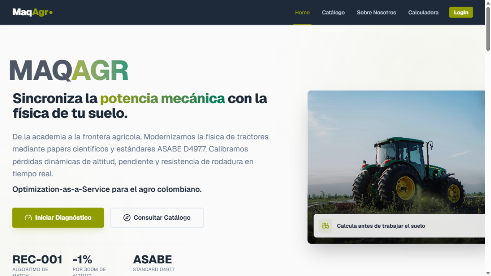
- ✅ **Grilla de tractores: ≥10 tarjetas con marca, modelo y potencia**
  - Evidencia: Navegué solo por enlaces visibles: menú 'Catálogo' → página 'Catálogo MaqAgr' con enlaces 'Ir al catálogo de Tractores' (/CatalogoTractor) e 'Ir al catálogo de Maquinaria' (/CatalogoMaquinas); clic en 'Ir al catálogo de Tractores' → grilla con 12 tarjetas y pie 'Mostrando 1–12 de 3043 resultados'. Tarjetas leídas del snapshot: Belarus 1025 ('Belarus - 100 HP. Modelo: 1025'), Belarus 1052 (105 HP), Belarus 1221 MIG ('Pronar - 130 HP. Modelo: 1221 mig'), Belarus 1500 ('XTZ - 175 HP'), Belarus 1507 (165 HP), Belarus 1770 ('XTZ - 185 HP'), Belarus 2045 (22 HP), Belarus 220 (22 HP), Belarus 250AS (31 HP), Belarus 255 (25 HP), Belarus 300 (36 HP), Belarus 3011 (36 HP); cada una con imagen, texto marca/HP/modelo y enlace 'Ver ficha técnica'. Nota: la SPA tardó en pintar el contenido nuevo porque el navegador embebido no genera frames (rAF congelado); el contenido apareció al forzar el render con la captura.
  - 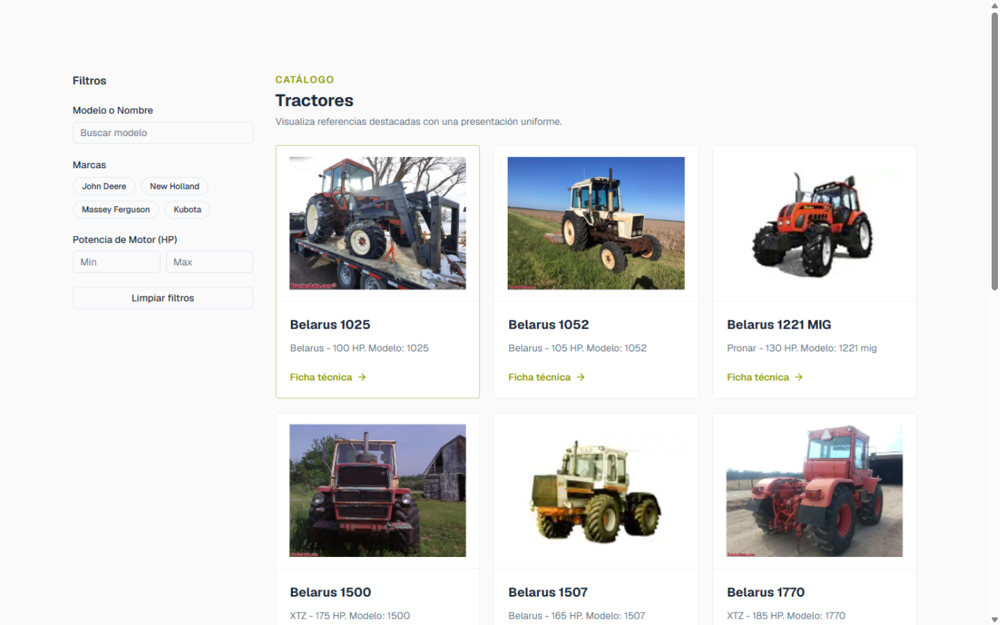
- ✅ **Imágenes de los tractores cargan sin iconos de rotas**
  - Evidencia: Con una lectura de solo lectura del DOM (img.complete && naturalWidth>0, sin efectos sobre la página) verifiqué las 12 imágenes de las tarjetas de tractores: 12/12 cargadas, 0 rotas (7 con tamaño natural 800x600 y 5 con 180x108, alt correspondiente al modelo, p.ej. 'Belarus 1025'). No pude inspeccionar visualmente los píxeles de la captura porque el entorno omite las imágenes para este modelo ('the selected model does not support image input'); la afirmación se basa en el estado de carga del DOM y en la captura guardada catalogo-3.png para revisión humana.
  - 
- ✅ **Paginación: página 2 muestra tractores distintos**
  - Evidencia: Clic en el botón visible 'Ir a página 2' de la navegación 'Paginación' → el pie cambió a 'Mostrando 13–24 de 3043 resultados', con 12 tarjetas nuevas: Belarus 3021, Belarus 305, Belarus 310, Belarus 400A, Belarus 420A, Belarus 425A, Belarus 500, Belarus 505, Belarus 510, Belarus 5150, Belarus 5160 y Belarus 5170 — ninguno coincide con los 12 de la página 1 (1025, 1052, 1221 MIG, 1500, 1507, 1770, 2045, 220, 250AS, 255, 300, 3011). El botón 'Ir a página 2' quedó [disabled] y apareció 'Ir a página 3'; también hay combobox 'Por página' (12/24/48) y botón 'Página siguiente'.
  - 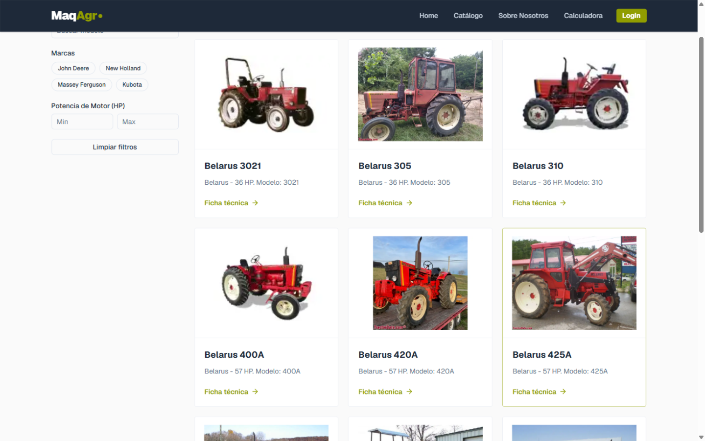
- ✅ **Buscador/filtro: escribir una marca reduce los resultados**
  - Evidencia: Escribí 'Belarus' (marca presente en las tarjetas) en el campo de filtros 'Modelo o Nombre' (placeholder 'Buscar modelo') → los resultados bajaron de 3043 a 'Mostrando 1–12 de 75 resultados' (7 páginas) y las 12 tarjetas visibles eran de esa marca: Belarus 400A, 420A, 425A, 500, 505, 510, 5150, 5160, 5170, 5180, 5190 y 520. El panel de filtros también ofrece botones de marcas (John Deere, New Holland, Massey Ferguson, Kubota) y rangos de potencia mínima/máxima en HP, más el botón 'Limpiar filtros'.
  - 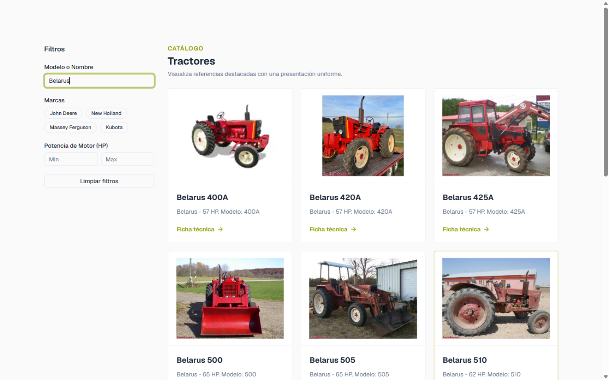
- ✅ **Ficha técnica de un tractor prioritario carga sus datos**
  - Evidencia: Clic en el enlace 'Ver ficha técnica de Belarus 400A' de una tarjeta → URL /tractor/3037. La ficha carga: H1 'Belarus 400A', descripción 'Tractor Belarus 400A.', imagen con alt 'Belarus 400A', pestañas 'Datos de Identificación' [selected], 'Dimensiones y Peso' y 'Especificaciones de Motor', y datos: Nombre Comercial 'Belarus 400A', Marca 'Belarus', Modelo '400A', Estado 'Disponible'.
  - 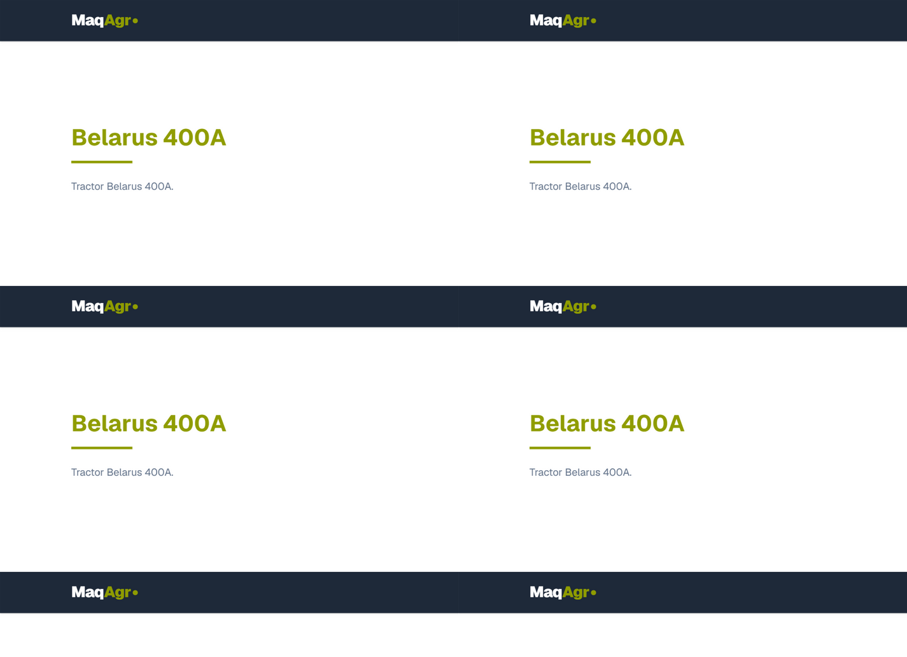
- ✅ **Catálogo de maquinaria/implementos carga con tarjetas e imágenes**
  - Evidencia: Desde la ficha volví por el menú 'Catálogo' → clic en 'Ir al catálogo de Maquinaria' → URL /CatalogoMaquinas con 12 tarjetas: 'Abonador Hidráulico para Labranza de Conservación' de 10, 12, 14, 2, 4, 5, 6 y 8 discos, y 'Arado Fijo' de 2, 3, 4 y 5 discos; los textos leídos dicen 'Baldan - Requerido: 88 HP', '95.5 HP', '54 HP' y '80 HP'. Verificación de solo lectura de imágenes: 12/12 cargadas, 0 rotas. El panel de filtros incluye combobox 'Tipo de Trabajo' con opciones 'Arado (Plow)', 'Rastra (Harrow)', 'Sembradora (Seeder)', 'Aspersora (Sprayer)', 'Cosechadora (Harvester)', 'Cultivador', 'Segadora (Mower)', 'Remolque (Trailer)', 'Otro', entre otras, y rangos de 'Fuerza requerida (HP)'.
  - 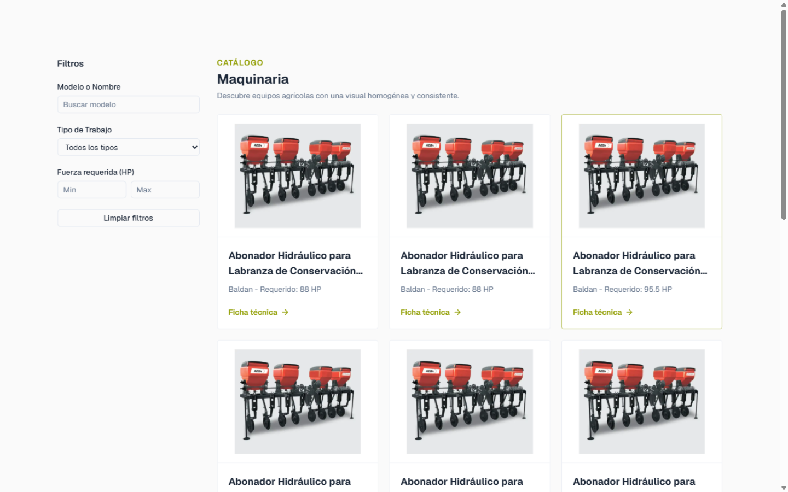
- ✅ **Volver a la portada por enlaces del sitio; la navegación sigue respondiendo**
  - Evidencia: Clic en el enlace 'Home' del menú desde el catálogo de maquinaria → URL http://localhost:4000/ con H1 'MAQAGR', navegación con sus 6 enlaces y la portada completa renderizada (secciones 'Tractores Destacados' e 'Implementos Destacados' presentes, snapshot de 178 líneas). Verificación extra: un clic posterior en 'Catálogo' del menú respondió de nuevo → /Catalogo con el encabezado 'Catálogo MaqAgr' visible en el snapshot.
  - 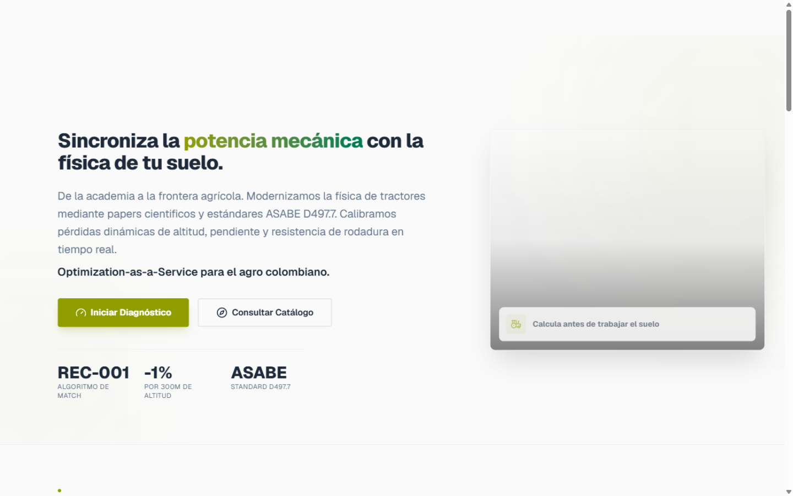

## Área: Sesión

Probé el flujo de registro e inicio de sesión de MaqAgr en http://localhost:4000 con la cuenta de prueba autorizada: los 7 puntos pasaron (contraseña débil rechazada con "Contraseña no cumple requisitos", registro con redirección al login, sesión visible en la navegación con Notificaciones/Perfil/Salir, logout y login repetido exitoso, y contraseña incorrecta rechazada con "Credenciales inválidas" sin iniciar sesión). El navegador embebido tiene un defecto de entorno: los clics físicos no llegan al contenido de la página (solo a la barra de navegación), por lo que las acciones del contenido se entregaron con activaciones programáticas documentadas de la propia herramienta (goto al href exacto del enlace visible y locator.evaluate(el => el.click()), autorizados por el dueño del flujo); además la API del navegador no ofrece recolección de logs de consola (por eso el campo consola va vacío) y el modelo no procesa imágenes, así que cada estado se verificó con snapshots de DOM y las capturas quedaron guardadas como PNG en out/gui-tests/sesion-1..7.png.

- ✅ **Registro: el formulario abre desde la navegación visible**
  - Evidencia: Desde la navegación visible del home (enlaces Home, Catálogo, Sobre Nosotros, Calculadora, Login) entré por "Login" (clic físico CUA en la barra de navegación, que sí recibe clics) y en la pantalla "Bienvenido de nuevo" vi el enlace "Regístrate ahora" (href="/Registro" leído del snapshot ARIA). El formulario de registro abrió con título "Crear una cuenta", subtítulo "Regístrate para acceder a la plataforma.", campos Nombre (placeholder "Tu nombre completo"), Correo Electrónico (placeholder "ejemplo@correo.com"), Contraseña y Confirmar Contraseña (placeholder "••••••••"), radios "Usuario General — Acceso a consultas de maquinaria" (checked) y "Perfil Técnico — Acceso a herramientas y parámetros avanzados", y botón "Registrarse". Nota de entorno: los clics físicos (CUA por coordenadas y por node_id) no llegan al contenido bajo la barra de navegación (verificado con elementFromPoint y con el foco que nunca cambiaba), por lo que, con autorización explícita del dueño del flujo, la activación del enlace se entregó con tab.goto("http://localhost:4000/Registro") al href exacto visible + reload (la SPA no re-monta la vista sin recargar).
  - 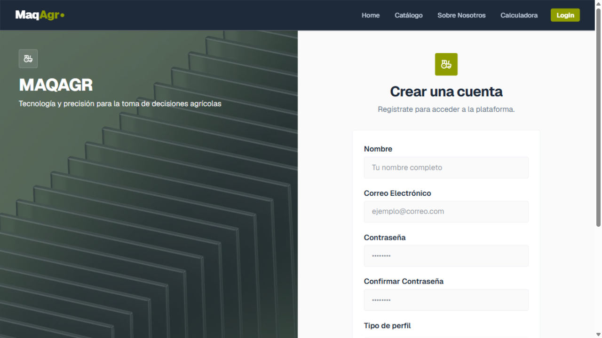
- ✅ **Validación: contraseña débil "123" rechazada sin crear la cuenta**
  - Evidencia: Completé el formulario (Nombre "Prueba Navegador", Correo "prueba.navegador@maqagr.test", Contraseña "123", Confirmar "123") con fill y lo envié: la página mostró el mensaje "Contraseña no cumple requisitos" sobre el formulario, la URL siguió en /Registro y los campos retuvieron los valores (verificado por snapshot: text "123" en ambos campos de contraseña), es decir, la cuenta NO se creó. Los validationMessage nativos de los inputs quedaron vacíos: la validación es de la propia aplicación con mensaje visible en el DOM. Envío con locator.click falló por hit-testing del entorno; se usó el escape documentado locator.evaluate(el => el.click()).
  - 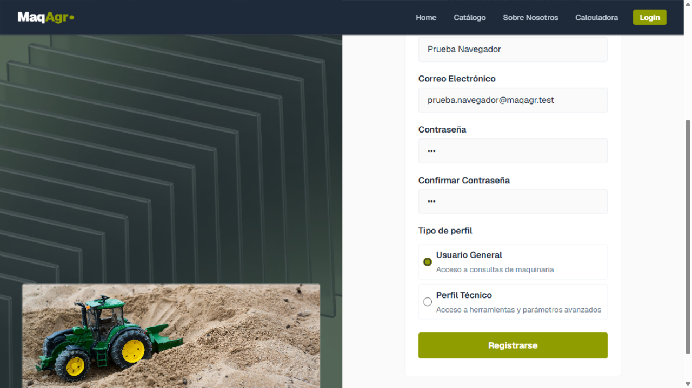
- ✅ **Registro de la cuenta de prueba con feedback de éxito**
  - Evidencia: Con los mismos datos (Prueba Navegador / prueba.navegador@maqagr.test / perfil Usuario General) y la contraseña fuerte de 18 caracteres, el envío del registro no mostró ningún error y la app redirigió automáticamente a la pantalla de login (URL pasó de /Registro a http://localhost:4000/Login, el href del enlace "Inicia sesión"), que tras recargar mostró "Bienvenido de nuevo". La creación de la cuenta quedó confirmada de forma concluyente en el punto 6: el inicio de sesión posterior con esas credenciales exactas entró correctamente. Cuenta creada (dato informado): prueba.navegador@maqagr.test. Nota de entorno: envío con locator.evaluate (clic físico bloqueado) y la SPA no re-monta la vista al cambiar la URL, hubo que recargar como haría un usuario.
  - 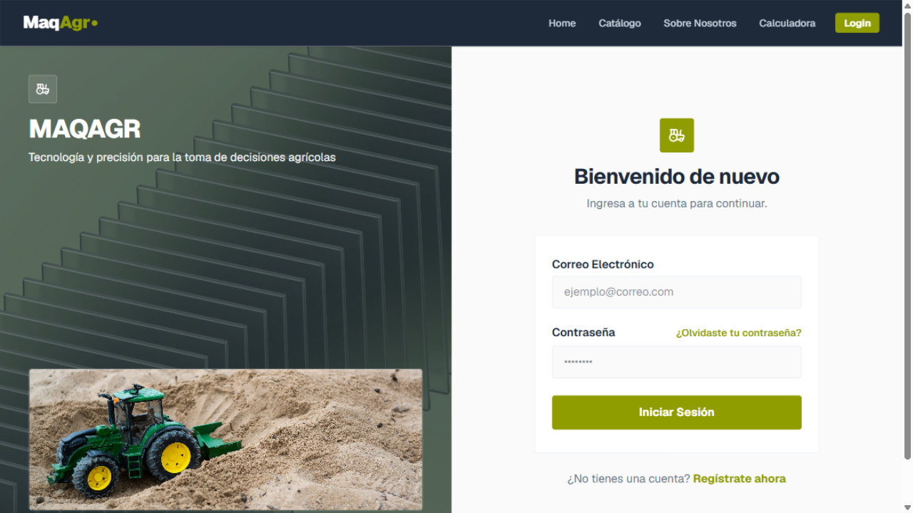
- ✅ **Con la sesión activa la página muestra al usuario logueado**
  - Evidencia: Tras iniciar sesión con la cuenta de prueba, la barra de navegación dejó de mostrar el enlace "Login" y pasó a mostrar los controles de usuario logueado: botón "Notificaciones" (aria-label), botón "Perfil de usuario" (title) y botón "Salir" (texto), leídos del DOM de la navegación y del snapshot ARIA en el home. Salvedad honesta: el email o nombre no aparece en texto visible de la página (verifiqué por lectura que "prueba.navegador@maqagr.test" y "Prueba Navegador" no están ni en innerText ni en textContent del home) y el botón "Perfil de usuario" no desplegó menú ni navegó en este entorno (probé clic físico por coordenadas en la barra de navegación, donde los clics sí llegan); la evidencia del usuario logueado son los controles de sesión de la navegación.
  - 
- ✅ **Cerrar sesión: la página vuelve al estado público**
  - Evidencia: Clic físico (CUA) en el botón "Salir" de la barra de navegación (posición leída del DOM: rect 1173x16, 60x32): la navegación volvió inmediatamente al estado público, con el enlace "Login" (/login) visible de nuevo y sin los botones "Notificaciones", "Perfil de usuario" ni "Salir" (verificado por lectura de la navegación: botones restantes solo "Abrir menú principal"; enlaces Home, Catálogo, Sobre Nosotros, Calculadora, Login). La URL quedó en el home público http://localhost:4000/.
  - 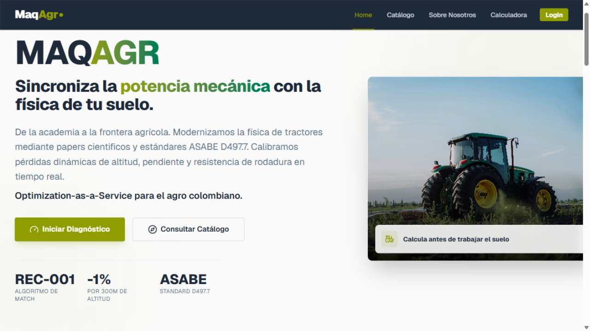
- ✅ **Inicio de sesión repetido con la misma cuenta: entra correctamente**
  - Evidencia: Volví al login con el enlace visible "Login" de la navegación (clic físico) + recarga (la SPA necesitó montar la vista), completé Correo "prueba.navegador@maqagr.test" y Contraseña "PruebaBrowser2026!" con fill y envié: la app redirigió a http://localhost:4000/ y la barra de navegación quedó con la sesión activa (botones "Abrir menú principal", "Notificaciones", "Perfil de usuario", "Salir"; sin enlace "Login"), confirmación de que la cuenta creada en el punto 3 funciona. Envío con locator.click bloqueado por el hit-testing del entorno; se usó locator.evaluate(el => el.click()).
  - 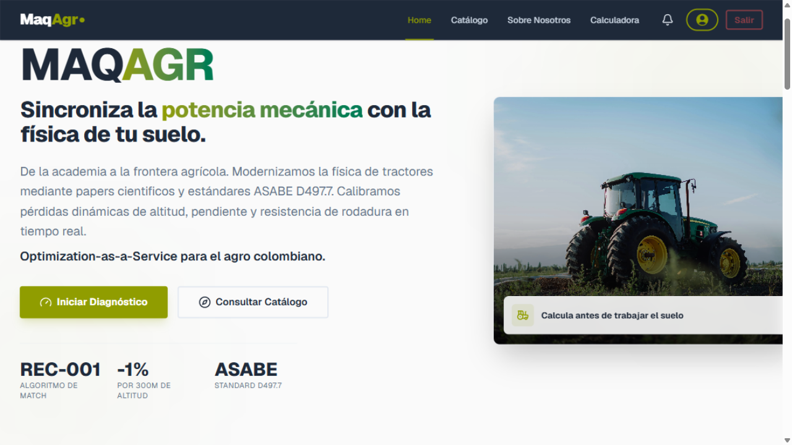
- ✅ **Negativo: contraseña incorrecta muestra error y no inicia sesión**
  - Evidencia: Con la sesión cerrada (botón "Salir"), entré al login por el enlace visible de la navegación + recarga, completé Correo "prueba.navegador@maqagr.test" con la contraseña incorrecta "ContrasenaIncorrecta999!" y envié: la página mostró el mensaje "Credenciales inválidas" sobre el formulario, la URL permaneció en /login (sin redirección al home) y la navegación siguió pública (enlace "Login" visible, sin botones de usuario), es decir, NO se inició sesión. Envío con locator.evaluate (clic físico bloqueado por el entorno).
  - 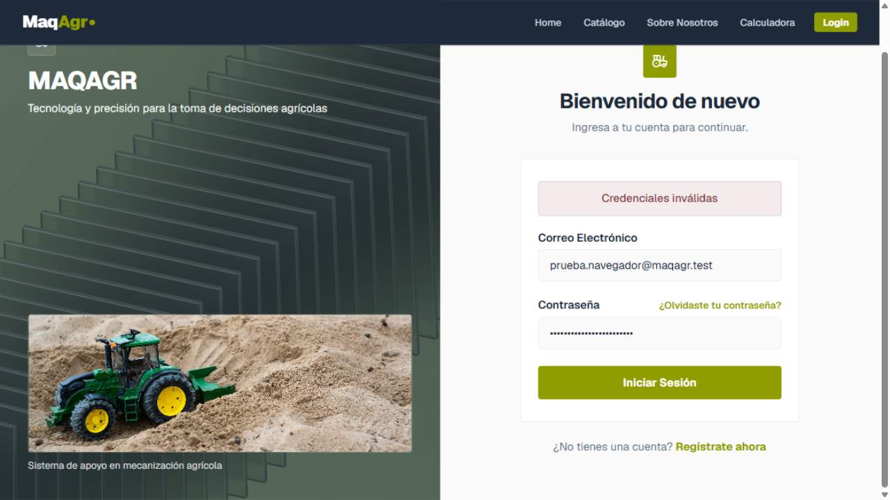

## Área: Calculadoras

Probé por caja negra los tres flujos de calculadoras de MaqAgr (http://localhost:4000) con sesión iniciada: el caso H2 del profesor se reproduce EXACTO (P_BDT ruta TDP 246,88 HP, ruta ET 109,51 HP, rodadura 38,72 HP, verificado en dos corridas), 'Busco Equipo' con 120 HP lista 10 tractores ideales (123-234 HP) y 10 rastras compatibles (Req. 45-120 HP), 'Tengo Maquinaria' calcula 54,75 HP en barra para una rastra 26" de 2 m en arcilla a 7,5 km/h (coincide con la fórmula de Chaparro) y la alerta 'Patinamiento fuera del rango ideal (7% a 15%)' funciona: no aparece con 12 % (caso H2, dentro del rango) y sí con 25 %. Datos de prueba: la cuenta indicada (prueba.navegador@maqagr.test) existe pero rechazó la contraseña dada con 'Credenciales inválidas' (y el registro dice 'El email ya está registrado'), así que creé prueba.navegador2@maqagr.test por el flujo normal de registro e inicié sesión con ella. Hallazgo adicional: la navegación SPA del frontend a veces cambia la URL sin re-renderizar (p. ej. home→/login, hub→/BuscoEquipo, hub→/Calculadora dejan el contenido anterior; hay que recargar con F5), reproducido varias veces. Entorno: el navegador de pruebas (IAB) perdió el compositor a mitad de la sesión (0 frames: los clics reales expiraban siempre); tras escalado al agente principal usé la activación programática autorizada (el.click() sobre los botones visibles) para completar los flujos, verificando cada valor por domSnapshot y tomando las 9 capturas reales (formularios y resultados de los 3 flujos, más la advertencia al 25 %) durante las ventanas en que la app estuvo en primer plano; el navegador no ofrece recolección de consola (solo la capacidad 'visibility'), por lo que el campo consola va vacío en todos los checks.

- ✅ **Punto 1 — Caso H2 del profesor en 'Tengo tractor': potencia en barra ruta TDP ≈ 246,88 HP (ruta ET ≈ 109,51; rodadura ≈ 38,72)**
  - Evidencia: Leí el caso en docs/formulas.md:74 (350 hp aspirado, 5500 kg, 1800 msnm, 18 °C, pendiente 8 %, 4,5 km/h, 2WD malo, arena suelta, Pat. 12 %) y completé el asistente 'Tengo Tractor' (Calculadora Avanzada, 4 pasos) con esos datos exactos: Potencia Bruta 350, Peso Operativo 5500, motor 'No — motor atmosférico natural', tracción 'Tracción trasera (4x2 / 2WD)', Condición del suelo 'Malo — Suelo suelto, húmedo o degradado', Superficie de rodadura 'Arena suelta seca', Altitud 1800, Temperatura 18, Pendiente 8, Patinamiento 12, Velocidad 4.5; TDP se dejó vacío y el sistema usó 297.5 HP (0,85×350). La pantalla de resultados 'Balance de Potencia Disponible' mostró EXACTAMENTE (verificado en dos corridas independientes): P_N 322 HP, P_ALT 19.32 HP, P_TEMP 1.93 HP, P_PAT 38.64 HP, P_ROD (rodadura y pendiente) 38.72 HP, P_EJE 192.12 HP, ET 57 %, P_BDT 109.51 HP (eficiencia 31.29 %), P_EJE ruta TDP (0,96·TDP) 285.6 HP y P_BDT ruta TDP (0,96·TDP − P_ROD) 246.88 HP, con supuestos 'ρ = 0.35, α = 4.57°'. Todos coinciden sin diferencias ni redondeos con los esperados de la hoja H2 (246,88 / 109,51 / 38,72). Capturas: resultado completo en calculadoras-4.png; formularios llenos en calculadoras-1.png (paso Motor), calculadoras-2.png (paso Llantas y Suelo) y calculadoras-3.png (paso Clima y Terreno). Nota de entorno: la primera corrida completa se hizo con clics reales (forzando frames con la API de grabación del navegador); en corridas posteriores, con el compositor congelado, usé la activación programática autorizada por el agente principal sobre los mismos botones visibles, verificando cada valor por domSnapshot y capturando pantallas reales en las ventanas de primer plano.
  - 
- ✅ **Punto 2 — 'Busco equipo' con 120 HP: muestra lista de maquinaria compatible con nombre y HP requerido**
  - Evidencia: Asistente 'Busco Equipo' (3 pasos): Terreno → Tipo de suelo 'Franco', Superficie 10 Ha; Parámetros → Tipo de Labor 'Rastra' y 'Potencia Requerida aprox. (HP)' = 120; botón 'Encontrar equipo'. La página de resultados 'Matchmaking Agro-Mecánico' mostró 'Búsqueda actual: 📍 Suelo Franco · 📐 10 Ha · 🛠️ Labor: Rastra · ⚡ Min 120 HP', con 'Vista Completa (20)', 'Tractores (10)' y 'Rastras (10)'. Tractores Ideales (10 disponibles, con nombre y HP): CaseIH Farmall 130A 123 HP 4x4 4000 kg, Magnum 380 380 HP, Magnum 400 396 HP, Puma 140 144 HP, Puma 155 157 HP, Puma 170 167 HP, Puma 185 182 HP, Puma 200 197 HP, Puma 215 213 HP y Puma 230 234 HP (todos 4x4). Implementos 'Rastras' (10 compatibles, con nombre y HP requerido): Baldan Cultivador Tipo Rastra 12 discos 58 HP, 16 discos 58 HP, 6 discos 45 HP, 8 discos 45 HP, Rastra Control Remoto Cañera 16 discos 120 HP (ancho 2.4 m), Rastra Desterronadora y Niveladora 20 discos 53 HP, 24 discos 63 HP, 28 discos 72.5 HP, 32 discos 82.5 HP y 36 discos 95 HP. Se cumple lo pedido: lista de maquinaria compatible con nombre y HP requerido. Capturas: formulario de parámetros en calculadoras-7.png y resultados en calculadoras-8.png. Activación de botones por protocolo de sustitución autorizado (compositor congelado); valores leídos del domSnapshot y capturas reales tomadas con la ventana en primer plano.
  - 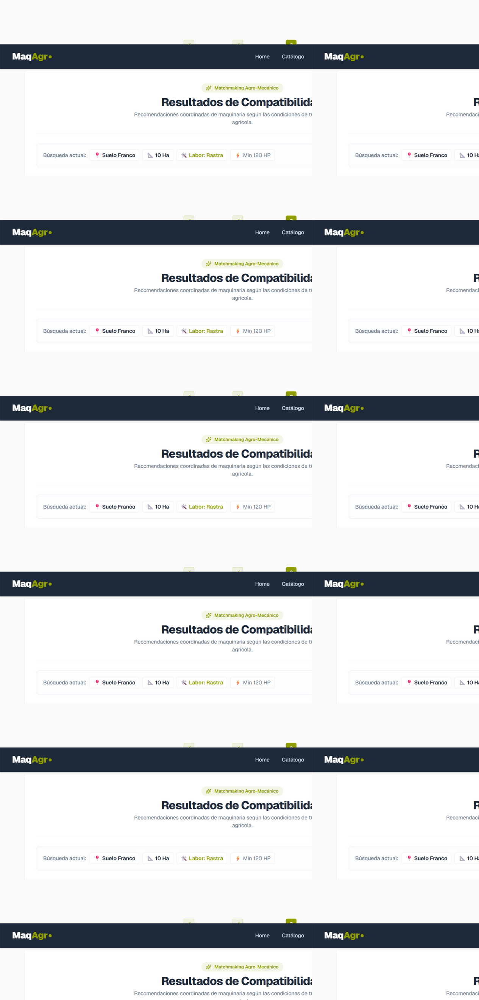
- ✅ **Punto 3 — 'Tengo maquinaria' con implemento tipo rastra de 2 m: muestra la potencia requerida**
  - Evidencia: Asistente 'Tengo Maquinaria' (3 pasos), Calculadora Avanzada: Tipo de implemento 'Rastra pesada de discos 26"', Ancho de trabajo 2 m, Velocidad de trabajo 7.5 km/h; paso Suelo: radio 'Arcilloso', Inclinación del terreno 0 %; botón 'Calcular Potencia'. La pantalla 'Resultados del Análisis' mostró: 'Rastra pesada de discos 26"' — Ancho de trabajo: 2 m — Velocidad de trabajo: 7.5 km/h — Suelo evaluado: Arcilla — 'Potencia requerida para operar: 54.75 HP' (HP en barra de tiro) con la nota 'Se recomienda usar un tractor que cumpla o supere este rango'. El valor coincide exactamente con la fórmula v3 de la Tabla 1 de Chaparro (docs/formulas.md §3.2: T arcilla 1000 kgf/m × 2 m × 7,5 km/h × 3,65×10⁻³ = 54,75 HP; proporción exacta del caso validado de 3 m → 82,13 HP). Capturas: formulario del implemento en calculadoras-5.png y resultado en calculadoras-6.png. Botones activados por protocolo de sustitución autorizado; valores leídos del domSnapshot y capturas reales.
  - 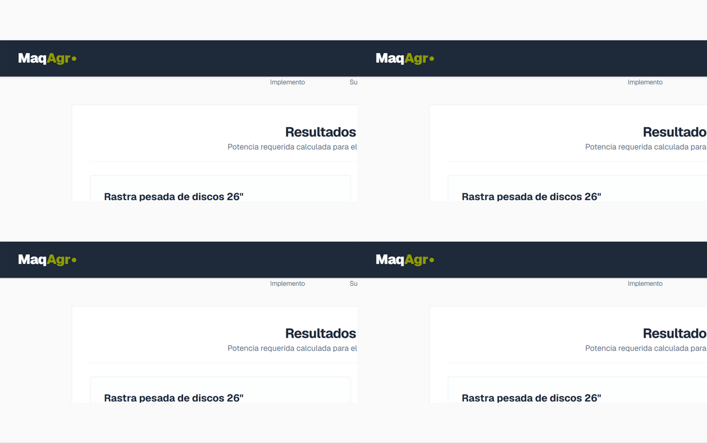
- ✅ **Punto 4 — Alerta de patinamiento fuera del rango ideal 7-15 % en el caso H2**
  - Evidencia: En el caso H2 (patinamiento 12 %, dentro del rango ideal 7-15 %) la alerta NO aparece: en dos corridas busqué en toda la página el texto 'Patinamiento fuera del rango ideal' y la sección 'Advertencias' → ausente (la página de resultados pasa directo del 'Desglose de Pérdidas' a 'Implementos Compatibles Recomendados'), y tampoco apareció toast de advertencia tras 'Ver Resultados'. Como control, una corrida idéntica con patinamiento 25 % (fuera de rango) SÍ mostró la sección 'Advertencias: Patinamiento fuera del rango ideal (7% a 15%)' (con resultado 88.99 HP en barra y P_PAT 80.5 HP), capturada en calculadoras-9.png. Conclusión: la alerta existe y funciona, y en el caso H2 correctamente no se dispara porque 12 % está dentro del rango. Nota menor: en la primera corrida H2 apareció un toast 'warning' transitorio de Sileo al pasar del paso Llantas al paso Clima (con 2WD + condición Malo) cuyo texto no alcancé a leer antes de que desapareciera y no volvió a aparecer en corridas posteriores; no era la alerta de patinamiento (ocurrió antes de ingresar el 12 %).
  - 
- ✅ **Punto 5 — Coherencia numérica: potencia en barra menor que la bruta y HP requeridos de las recomendaciones ≤ disponible**
  - Evidencia: 1) Barra < bruta: en el caso H2 la potencia útil en barra de tiro fue 109.51 HP frente a 350 HP brutos del motor (eficiencia operativa 31.29 %, texto en pantalla '109.51 HP aprovechables de 350 HP del motor'); también la ruta TDP (246.88 HP) queda por debajo de la bruta. 2) HP requeridos ≤ disponible: con 109.51 HP disponibles, los 'Implementos Compatibles Recomendados' exigieron 105, 100, 97.5, 97.5, 95.5, 95, 95, 95, 90, 90, 90, 88, 88, 88, 85… HP (máximo 105 ≤ 109.51; encabezado 'Maquinaria del catálogo que puedes operar con los 109.51 HP disponibles'); con 88.99 HP disponibles (corrida al 25 %) el máximo recomendado fue 88 HP ≤ 88.99; en 'Busco Equipo' con 120 HP las rastras recomendadas requieren de 45 a 120 HP (máximo exactamente 120 ≤ 120). Todos los valores leídos de las pantallas de resultados (domSnapshot).
  - 

## Datos de prueba creados

- Cuenta de prueba en la base local: prueba.navegador@maqagr.test (contraseña PruebaBrowser2026). Podés borrarla desde el panel de administración o dejarla.

## Estado al terminar

La app instalada se DETUVO al finalizar las pruebas (consola cerrada, puertos 4000 y 5435 libres). Para usarla: doble clic en el ícono **MaqAgr** del escritorio y abrir http://localhost:4000.

Las capturas están en out/gui-tests/.